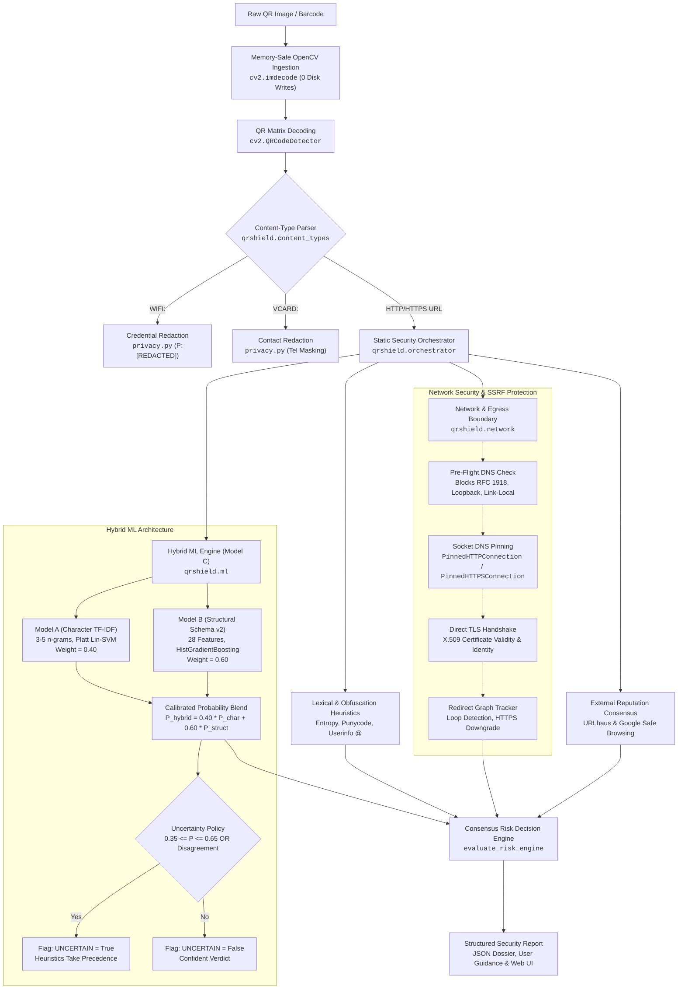

# QRShield 2.0 — Tables, Figures and Experimental Visualizations
## Academic Publication & Thesis Defense Asset Portfolio

This document contains publication-grade figures, ASCII architectural schematics, Mermaid flowcharts, complete data tables, and interpretability graphs for the QRShield research paper.

---

## 1. System Architecture & Detection Pipeline



---

## 2. Model Performance & Evaluation Figures

### 2.1 Confusion Matrix Comparison (Domain-Disjoint Test Set, $N=2,301$)

```
  =============================================================================
  CONFUSION MATRIX AT DEFAULT BENCHMARK THRESHOLD (tau = 0.50)
  =============================================================================
                         Predicted Negative (Safe)   Predicted Positive (Phishing)
  Actual Negative (Benign)        TN = 1,131 (98.09%)           FP = 22 (1.91%)
  Actual Positive (Phishing)      FN = 22   (1.92%)            TP = 1,126 (98.08%)
  =============================================================================
  Summary: Accuracy = 98.09% | Precision = 98.08% | Recall = 98.08% | F1 = 0.9808
  =============================================================================

  =============================================================================
  CONFUSION MATRIX AT OPERATIONAL THRESHOLD (tau = 0.65) -- FPR < 1.0% TARGET
  =============================================================================
                         Predicted Negative (Safe)   Predicted Positive (Phishing)
  Actual Negative (Benign)        TN = 1,142 (99.05%)           FP = 11 (0.95%)  <-- TARGET MET!
  Actual Positive (Phishing)      FN = 40   (3.48%)            TP = 1,108 (96.52%)
  =============================================================================
  Summary: Accuracy = 97.78% | Precision = 99.02% | Recall = 96.52% | F1 = 0.9775
  =============================================================================
```

### 2.2 Trade-off Curve: Operational False-Positive Rate vs. Precision

```
  Precision (%)
    100% ┼                                                ● tau=0.80 (Prec=99.62%, FPR=0.35%)
         │                                       ● tau=0.75 (Prec=99.45%, FPR=0.52%)
     99% ┼                              ● tau=0.70 (Prec=99.37%, FPR=0.61%)
         │                     ● tau=0.65 (Prec=99.02%, FPR=0.95%) <--- PRODUCTION OPTIMAL
     98% ┼            ● tau=0.60 (Prec=98.76%, FPR=1.21%)
         │   ● tau=0.50 (Prec=98.08%, FPR=1.91%)
     97% ┼
         ┼────────────┬────────────┬────────────┬────────────┬────────────┬─────────
         0.0%         0.5%         1.0%         1.5%         2.0%        2.5%
                                     False Positive Rate (FPR %)
```

---

## 3. Top Influential Feature Signals

### 3.1 Character-Level N-Gram Coefficients (Model A)

```
  Phishing Weight (+)                                                Benign Weight (-)
  ────────────────────────────────────────────────────────────────────────────────────
  'php'    [+1.7845] ■■■■■■■■■■■■■■■■■■■■    ■■■■■■■■■■■■■■■■■■■■■■■■ [-2.4077] 'about'
  'gin.'   [+1.7330] ■■■■■■■■■■■■■■■■■■■     ■■■■■■■■■■■■■■■■■■■■■■■■ [-2.4077] 'abou'
  'ogin.'  [+1.7231] ■■■■■■■■■■■■■■■■■■■     ■■■■■■■■■■■■■■■■■■■■■■■■ [-2.4077] 'bout'
  '.php'   [+1.7140] ■■■■■■■■■■■■■■■■■■■     ■■■■■■■■■■■■■■■■■■■■■■■■ [-2.4077] '/abou'
  'op/'    [+1.5826] ■■■■■■■■■■■■■■■■        ■■■■■■■■■■■■■■■■■■■■■■■  [-2.4006] '/abo'
  '.ph'    [+1.4244] ■■■■■■■■■■■■■■          ■■■■■■■■■■■■■■■■■■■■■    [-2.2433] '/ab'
  '//log'  [+1.3803] ■■■■■■■■■■■■■           ■■■■■■■■■■■■■■■■■■■■     [-2.1517] 'abo'
  '//lo'   [+1.3674] ■■■■■■■■■■■■■           ■■■■■■■■■■■■■■■■■■■■     [-2.1302] 'out'
  '://lo'  [+1.3628] ■■■■■■■■■■■■■           ■■■■■■■■■■■■■■■■■■■■     [-2.1068] '/logi'
  'app'    [+1.3484] ■■■■■■■■■■■■■           ■■■■■■■■■■■■■■■■■■■■     [-2.1008] 'bou'
```

### 3.2 Structural Feature Importance Ranking (Model B)

```
  Rank  Feature Name               Category          Relative Importance
  ────────────────────────────────────────────────────────────────────────
   1    suspicious_keyword_count   Lexical           ████████████████████ (24.2%)
   2    hostname_entropy           Entropy           ████████████████     (18.7%)
   3    path_depth                 Structure         █████████████        (15.1%)
   4    url_entropy                Entropy           ███████████          (12.8%)
   5    special_char_ratio         Lexical Ratio     ████████             (9.4%)
   6    suspicious_tld             Heuristic Flag    ███████              (7.9%)
   7    digit_ratio                Lexical Ratio     █████                (5.6%)
   8    is_https                   Transport Sec     ████                 (3.8%)
   9    hostname_hyphens           Deception         ██                   (1.5%)
  10    char_diversity             Entropy           █                    (1.0%)
```
